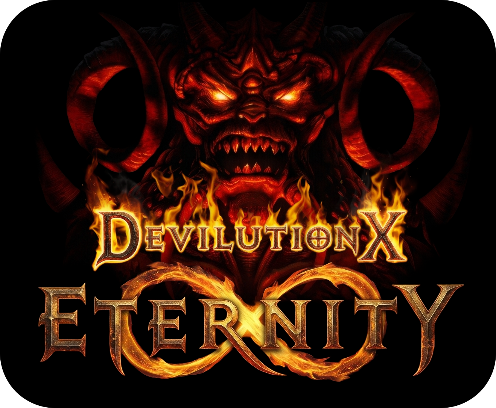
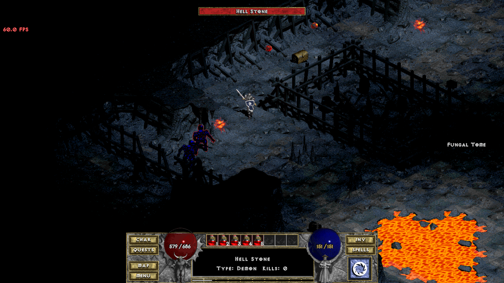
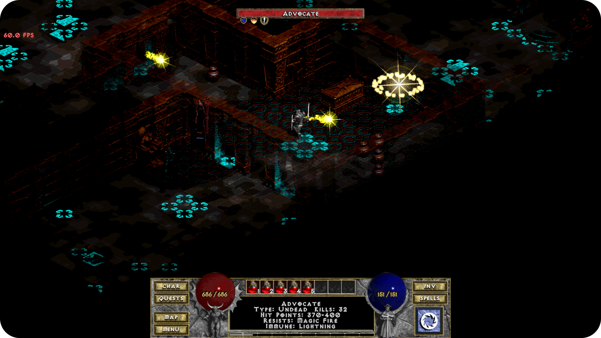
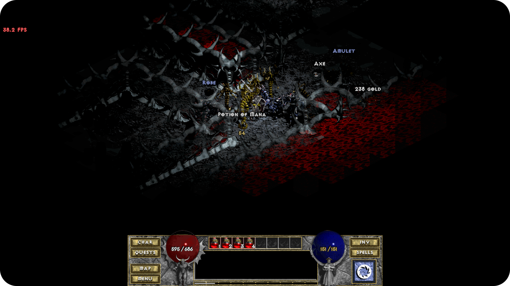
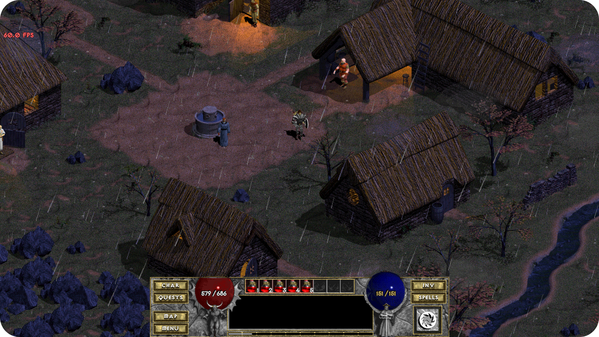

  

# DX:Eternity

Built on top of the [DevilutionX](https://github.com/diasurgical/devilutionX) engine, this project brings greater variety, enhanced visuals and modern acoustic fidelity to vanilla Diablo. Without unnecessary feature bloat, it carefully maintains the raw pace, tone, and itemization of the 1996 original.

---

## Key Features

### 3D Spatial Audio, EFX Dungeon Reverb & Binaural HRTF
- **OpenAL Soft + EFX Environmental Reverb:** Every dungeon features custom acoustic reverberation profiles.
- **Dynamic Wall Occlusion:** Sound sources originating behind solid dungeon geometry are dynamically muffled using EFX low-pass filtering while preserving open-air corridor travel.
- **Surround Sound & Headphone HRTF:** Native 3D positional audio with full support for multichannel speaker layouts and binaural HRTF.

---

### Dungeon Palette Randomization
- Dynamically randomizes color palettes across dungeons, introducing distinct environmental variety.
- Adapted and integrated from [DevilutionXRandomizer](https://github.com/stoffelkopf/DevilutionXRandomizer) by **stoffelkopf**.

---

### Dynamic Weather & Environmental Atmosphere (WIP)
- **Tristram Rainfall:** Ambient rainfall layer across town.
- **Interactive Ground Fog**: Volumetric mist that reacts to  movement.

---

### Seamless Dungeon Branches: Hive & Crypt
*Hellfire's* dungeons are woven directly into the natural labyrinth descent:
- **The Hive:** Accessible via a downward stairway on **Caves Level 12**.
- **The Crypt:** Accessible via a descent discovered on **Hell Level 14**.
- Both branches utilize pure vanilla Diablo I drop and affix tables.
- Out-of-place *Hellfire* sprites have been replaced with proper, dark-fantasy D1 counterparts (including Magma Demons, Counselors, Advocates, Drakes, and Blood Knights) while retaining their aggressive projectile and elemental hazard behaviors.

---

### New Class Archetype: The Female Barbarian
Pairs the Rogue’s visuals and voice lines with the cut *Hellfire* Barbarian class mechanics:
- **Attributes:** High Strength and Vitality caps with zero Magic affinity.
- **Mastery & Traits:** Full two-handed weapon proficiency (wielding two-handed swords, clubs, and axes with one-handed shield blocking mechanics), innate stun/knockback advantages and the active **Rage** skill.

---

### Hell Difficulty Endgame Drops
Slaying Diablo on **Hell difficulty** yields an independent **2% (1-in-50) drop chance** for each of three new unique artifacts:

| Item | Base | Stats & Mechanics |
| :--- | :--- | :--- |
| **Kadi's Fury** | Broad Sword | `+100% To Hit`, `+175% Damage`, `Fastest Attack`, `+4–16 Lightning Damage`, `Faster Walk`, `Resist All: -30%`, `Indestructable` |
| **Apostate's Crook** | War Staff | `+2 to All Spell Levels`, `+40 to Magic`, `+80 to Maximum Mana`, `Damage Reduced by 8`, `-50 to Armor Class`, `Resist All: -30%` |
| **Loxley's Bend** | Long War Bow | `Knocks Target Back`, `+40 to Dexterity`, `+30 to Maximum Damage`, `Steals 5% Mana (works on ranged hits)`, `-40% Light Radius`, `-50 to Maximum Life` |

---

## Other Gameplay & Polish Changes

- Restores randomized walking sound effects originally commented out in the 1996 Blizzard North source code.
- Silences the repetitive Defiler monologue pop-ups upon entering the Hive.
- Slaying Diablo in single player drops full boss loot and leaves the game session open, allowing you to clean up unfinished quests or explore secondary dungeon branches.
- Town entrance portals to the Catacombs, Caves, and Hell are unlocked from the start of a Single Player campaign.

---

## Roadmap / To-Do

- [ ] **Torment Difficulty:** An endgame difficulty tier scaled beyond Hell.
- [ ] **Cut Content Restoration:** Restoring select unreleased quests.
